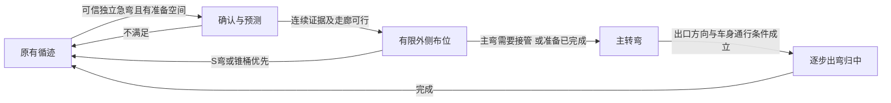

# 左右急弯：自主实跑与人工推车的复核、控制方案

日期：2026-10-12。本文保留分析阶段的结论与设计依据。**用户确认后的实施已经完成，当前状态见文末“后续实施记录”及其交接链接；下文的“待确认/未修改”是分析当时状态。**

## 1. 结论先行

用户希望在大急弯之前先向外侧布位、略增外移量，然后及时完成主转弯，同时保留当前直道、缓弯和 S 弯的良好表现。这个方向值得开展受限试验，但本批数据不支持直接套用旧分析中的“向外偏 230～612 mm、距弯 645～680 mm 打舵”。这两组数字的物理解释有误。

更合理的下一步是：**在仍有直行空间时识别独立急弯，以局部车道位置为反馈完成小幅外移；主转弯时及时解除准备阶段，保持弯墙身份和路径连续；出弯根据局部方向及车身空间逐步收舵。** 不能把“完成指定外移量”设为开始主转弯的前置死条件。

本批证据还指出两个独立问题：

- 六次自主实跑均有较长的接近软件舵量边界的区间。继续提高全局 Kp 不能解决已经饱和的区间。
- 后两次自主左弯的感知无效明显多于成功手推左弯。必须一并排查边界身份、可见近段和路径切换，不能只修改外移量。

**“方案不影响其他赛道”现在仍是验收要求，不是已经得到实车证明的事实。** 所有下述新逻辑和试验数值均须用户确认后才能进入代码。

## 2. 本次核查范围与使用口径

本目录将 14 个视频放入同一复核索引：六次自主行驶、六次带遥测的人工推车、两次无遥测人工推车。八个成功示范的原拆解仍在上级目录 SUC01～SUC08；六次自主实跑的原拆解仍在 `../../拆解_AI可读_20261012`。

本轮重新完整解码 14 个原始 MP4，记录文件 SHA256、帧数和帧率；每片另保存 18 个分布全程的原片抽帧、两张九格概览。新概览只标**视频自身帧号和时间**，没有把未经验证的遥测时刻烧进画面。视频事件窗口是视觉阶段标注，不是精确舵角测量。原始视频的手持视角、遮挡和模糊限制了毫米级间隙及细小擦碰判断。

12 份原始 BIN 的 SHA256 均匹配各自 meta，V2 CRC/结构失败候选均为 0，接收到的 V2 消息 tx_seq 缺口均为 0。每份均恢复出 8 个完整、无块冲突的点云快照，共 96 份；六次手推为其中 48 份。

这不等于所有诊断记录均未丢失：有设备端 `tx_drop` 累计、有 DETAIL/PATH/RACE 缺失；165050 正式窗口内 CONTROL 存在 5398→5400 的缺口。`tx_seq` 连续与发送前丢弃不是同一件事。未用缺失值补 0。

所有正式配置都报告 `sha256-fa5446679f6de4a7`，直道上限 17、弯道 15、cx=10、基础 preview=700。12 组属于同一回退固件；参数以会话内配置为准，不采用旧文中的 cx=-27。

按 `(session, control_seq, param_revision)` 精确关联 CONTROL、DETAIL、PATH、RACE。十份 BIN 开头还含前一会话的 CONTROL；这些不是新的 run 正式数据。正式窗口采用 meta 的 `pre_roll_s..formal_end_s` 且匹配当前 session。点云传输发生在点停止之后，但其原始 `control_seq/input_us` 可位于正式采集前；不按点云接收时间判断车辆位置。

用户本次明确说明：**六次手推只切断电机驱动电源，舵机仍自动控制，尽量沿轮向推动。** 这支持把它们作为低速自动转向的可行轨迹参考，而不是纯人工摆舵示范。六次正式 MOTOR 的 PWM 指令仍为 100、目标仍由速度闭环计算；电源切断不会让 MCU 的软件指令自动归零。不能把这些 MOTOR 指令当成电机实际输出动力，也不能直接移植这些 PI 积分状态。

### 正式采集区间统计

下表统计唯一 CONTROL，不把 30 fps 视频的重复配对行当作控制帧。速度为现有编码器单位；尚未校准成 m/s。接近舵量边界定义为 PWM≤1180 或 ≥1710，包含感知无效时保持的旧指令，不代表每帧均进行了有效计算。

| 采集 | 类型 | CONTROL | PD / 保持 / 感知无效 | 接近舵量边界帧 | 速度中位数 | 缺 DETAIL / PATH |
|---|---|---:|---|---:|---:|---|
| 160711 | 自主右 | 55 | 53 / 0 / 2 | 19 | 15.1 | 2 / 3 |
| 161100 | 自主右 | 43 | 43 / 0 / 0 | 19 | 15.1 | 2 / 4 |
| 161233 | 自主右 | 40 | 37 / 0 / 3 | 20 | 15.0 | 3 / 6 |
| 161426 | 自主左 | 45 | 43 / 1 / 1 | 19 | 15.0 | 2 / 3 |
| 161746 | 自主左 | 36 | 26 / 0 / 10 | 22 | 14.8 | 3 / 5 |
| 162029 | 自主左 | 55 | 27 / 4 / 24 | 36 | 14.8 | 3 / 3 |
| 164512 | 手推左 | 56 | 56 / 0 / 0 | 20 | 8.1 | 3 / 3 |
| 164616 | 手推左 | 55 | 55 / 0 / 0 | 17 | 8.2 | 2 / 3 |
| 164757 | 手推左 | 55 | 55 / 0 / 0 | 35 | 7.6 | 3 / 5 |
| 164942 | 手推右 | 44 | 43 / 0 / 1 | 31 | 9.35 | 2 / 3 |
| 165050 | 手推右 | 29 | 29 / 0 / 0 | 10 | 11.9 | 1 / 2 |
| 165134 | 手推右 | 40 | 36 / 4 / 0 | 24 | 11.3 | 3 / 3 |

控制周期约 75～93 ms，没有从这些区间看到几百毫秒一次的 CONTROL 周期。可见 HEALTH 的累计 process_max 不超过 9.669 ms，但并非每个 run 都收到 HEALTH，也不是整车所有延迟的总和。

### 视频观察索引

以下时间均为**原视频时间**，不能直接拿去索引 `host_t`。主弯窗口表示可以明显看到车身通过弧段，不是“第一帧舵机开始动作”。画面尺度随相机改变，外墙近/远仅作定性判断。

| 视频 | 可见阶段和重点 | 新概览 |
|---|---|---|
| 自主右 160711 | 约0～0.33 s有人扶持，随后自主；约2.4～4.1 s经过主弯，约4.5～5.2 s贴近出口外侧；与文件名及用户反馈一致 | [前段](160711/overview_0.jpg) / [后段](160711/overview_1.jpg) |
| 自主右 161100 | 约2.2～4.1 s主弯，约4.4～5.0 s出口外侧余量小；照片不足以逐帧确认轮胎是否轻擦 | [前段](161100/overview_0.jpg) / [后段](161100/overview_1.jpg) |
| 自主右 161233 | 约2.1～4.0 s主弯，约4.3～5.2 s沿外侧逼近出口；不能仅按末帧认定原因是过早回正 | [前段](161233/overview_0.jpg) / [后段](161233/overview_1.jpg) |
| 自主左 161426 | 约2.0～3.4 s进入主弯，约4.1～5.1 s出口右侧明显近墙，仍继续行驶 | [前段](161426/overview_0.jpg) / [后段](161426/overview_1.jpg) |
| 自主左 161746 | 约2.0～3.2 s主弯，约3.7～4.6 s逼近出口外墙，末段伴随管壁可见变化；需同时看失效序列 | [前段](161746/overview_0.jpg) / [后段](161746/overview_1.jpg) |
| 自主左 162029 | 约2.1～3.3 s主弯，约3.9～4.8 s外侧出口受挤；对应 run 有长段感知无效，但不强行确定碰撞对应哪个 seq | [前段](162029/overview_0.jpg) / [后段](162029/overview_1.jpg) |
| 手推左 164512 | 开始已靠右侧外墙；0～2.0 s保留外侧入弯位置，约2.4～4.4 s完成主弯，4.8 s后逐步顺向出口；手一直在车尾 | [前段](164512/overview_0.jpg) / [后段](164512/overview_1.jpg) |
| 手推左 164616 | 开始已处于外侧，约2.3～4.1 s主弯，4.5 s后向出口顺行；不是从中间开始完整展示主动外移 | [前段](164616/overview_0.jpg) / [后段](164616/overview_1.jpg) |
| 手推左 164757 | 拍摄朝向相反，外侧在画面左侧但仍是车身右侧；约2.3～4.6 s主弯，约4.9～6.5 s出口；人沿车尾随行 | [前段](164757/overview_0.jpg) / [后段](164757/overview_1.jpg) |
| 手推右 164942 | 前段靠车左侧准备，约1.7～3.7 s主弯，约4.1～5.8 s出口，后段仍有近墙段，并非全程宽裕 | [前段](164942/overview_0.jpg) / [后段](164942/overview_1.jpg) |
| 手推右 165050 | 约1.3～2.9 s主弯，约3.1～4.4 s出口；约4.17 s以后手开始离开车尾，整段主要仍是手推条件 | [前段](165050/overview_0.jpg) / [后段](165050/overview_1.jpg) |
| 手推右 165134 | 约0.8～2.8 s主弯，约3.1～4.8 s出口；起始姿态已经带一定方向，不能视为与另两次完全相同的直道初始条件 | [前段](165134/overview_0.jpg) / [后段](165134/overview_1.jpg) |
| 无遥测手推左 | 约0～3.2 s准备，约3.2～5.1 s主弯，约5.6～7.9 s出口；未测舵机指令/实际舵角 | [前段](manual_left_no_log/overview_0.jpg) / [后段](manual_left_no_log/overview_1.jpg) |
| 无遥测手推右 | 约0～3.1 s准备，约3.1～4.8 s主弯，约5.2～5.9 s出口；视频结束范围有限 | [前段](manual_right_no_log/overview_0.jpg) / [后段](manual_right_no_log/overview_1.jpg) |

这些示范共同支持“先留入弯空间，再建立持续主转向”的阶段顺序。它们没有完整测得从道路中央主动横移到外侧的距离和动态过程；**起始已经在外侧不等于现有程序已经实现提前布位**。手推成功也不能证明以 15 的弯速必然成功；转向执行、轮胎侧向力及可用时间均不同。

## 3. 必须纠正的旧拆解结论

1. **时间锚不是验证。** 视频无共同时间标记。编码器运动起点≠视频0秒，电机上电但车辆被扶持时尤其如此。手推时也不能假定拍摄和推动同时开始。A/B两种假设偏移相近不是误差上界；六组 A 都约0.41 s，也可能只是首个接收批次。串口会成批到达多帧；按相近 `host_t` 取 RACE 会把别的控制周期的数据贴到本帧。
2. **road_error 不是车身外移距离。** 它是 `cx - (target_x - avoid_offset)`，目标在前方，数值混合了横向位置、车身朝向、道路弯曲和参考距离；急弯外移也会影响目标。不能用摆舵前 `abs(road_error)` 最大来定义最靠外位置。500 mm道路、260 mm轮外缘宽时，平行车身居中最多仅有120 mm单侧静态余量，几百毫米的车身偏心也与此不相容。
3. **turn_distance_mm 不是物理到弯距离。** 本批对应 support/near_ref 的代码定义。support 在不同 model 下含义也不同：基础模型取 ref_y，局部模型取支持上界，弧形模型为受预瞄限制的累计弧长；不能一概称为“拟合窗口上界”。bend_rad 是角度量，不是弯道半径或曲率。
4. **两个拟合直线的交点不是已测拐点。** 固定窗口100～750、550～1300存在重叠。构造完全平滑、没有突变点的 `x=k*y²`，k取0.0002、0.0005、0.001，对这两段分别拟合，交点都约663.31 mm。可见“多次都约650～680 mm”可能来自窗口结构。斜率差接近门限时误差还会被放大。
5. **所谓独立点云验证不能成立。** 旧程序以x正负分墙。左弯外墙在近处x>0，远处会跨到x<0；右弯相反。重现原150 mm偏离算法后，外侧所在符号半平面里没有得到可配对的偏离点；另一半平面却混入跨轴后的外墙。因此原“同侧两法差≤50 mm”的结论无法重现。例如右弯165050的seq5385，拟合交点约649.8 mm，文中使用的另一半平面偏离点为801 mm，相差151.2 mm。原验证脚本也没有真正执行按相同seq配对并断言差值。
6. **大舵量阈值不是实际起转时刻。** `|PWM-1445|>150`只是人为定义的指令阈值，不是舵机开始动、前轮开始偏转或车身开始转弯。四次手推首次跨阈值发生在正式窗口之前；其中还存在尚未取得对应修订配置的阶段。应保留原序号，不把它精确对齐到视频某帧。

旧 README 和旧 aligned.csv/图片保留溯源；其中的“强验证”“直接可用距离”和未经同步的逐帧标注不作为新逻辑依据。

## 4. 重新计算的几何参照：能说什么，不能说什么

### 4.1 可见弯墙已经开始偏离近处直线的位置

本轮离线采用独立、可复算的定义：沿相邻射线组成连续点簇，允许同一外墙跨x=0；以100～350 mm内的50 mm分区中位点拟合近处切线，至少4个分区、法向RMS≤15 mm；向前寻找连续三个分区均向弯内偏离该切线≥50 mm的位置。报告第一个分区的y区间。

这称为**“外墙相对近处切线的50 mm偏离位置”**，不是真实弯道起点、最佳打舵点或剩余可行驶距离。50 mm是本次观察口径，不是标定后的竞速参数。区间宽50 mm来自分区分辨率，并非95%置信区间。脚本同时检查30/80 mm偏离门限和80/120/160 mm点簇断开门限。

| 成功示范 | 前四个冻结seq | 50 mm偏离位置的前向y区间，逐帧 | 图 |
|---|---|---|---|
| 左164512 | 1335～1338 | 500～550；550～600；550～600；600～650 mm | [同墙轮廓](164512/contour_reference.png) |
| 左164616 | 2110～2113 | 600～650；600～650；600～650；600～650 mm | [同墙轮廓](164616/contour_reference.png) |
| 左164757 | 3316～3319 | 550～600；600～650；550～600；550～600 mm | [同墙轮廓](164757/contour_reference.png) |
| 右164942 | 4568～4571 | 700～750；650～700；550～600；600～650 mm | [同墙轮廓](164942/contour_reference.png) |
| 右165050 | 5385～5388 | 650～700；700～750；650～700；600～650 mm | [同墙轮廓](165050/contour_reference.png) |
| 右165134 | 5913～5916 | 650～700；600～650；550～600；550～600 mm | [同墙轮廓](165134/contour_reference.png) |

24帧在三种点簇断开门限下得到相同分区，但改变偏离门限会明显改变位置；结果并不全部单调下降。车辆旋转、切线参考变化、噪声都会影响它。它证明这些快照里已经有连续可见的弯墙特征，可用于设计预告特征；**不能据此把触发距离固定为650 mm**。快照由事件触发冻结，存在选样偏差，未覆盖全部最早可识别时刻；还需检查完整扫描历史和早期直道反例。

### 4.2 外移量的合理口径

另对这四帧分别拟合左右近墙，只有两边近处拟合均通过、方向差<0.2 rad且各自|斜率|<0.6才保留。设前轴中心在雷达坐标(0,100 mm)，其到左右近墙拟合线的法向距离为dL、dR，则用 `(dL-dR)/2` 表示相对两墙等距位置的局部横向偏差；左弯取正号、右弯取负号转换为“向外为正”。

这是近墙近似平行时的**前轴局部位置估计**。100～350 mm的近墙拟合在前轴处只作短距离延伸；墙体曲率、不同扫描高度和轮胎形状都引入偏差。它不是雷达中心/后轴位置、不是相对起点的横移，也不是车身扫掠余量。输出无正式标定置信区间，报告四舍五入到毫米。

| 类型 | 入弯附近快照的向外偏差估计 |
|---|---|
| 自主右160711 / 161100 / 161233 | 约+43～+55 / +21～+34 / +32～+47 mm（各3个通过帧） |
| 自主左161426 / 161746 / 162029 | 约−12～+21 / −35～−11 / −10～−2 mm（各4个通过帧） |
| 成功手推左164512 / 164616 / 164757 | 约−5～+1 / −19～−8 / −17～−2 mm（4 / 4 / 3帧） |
| 成功手推右164942 / 165050 / 165134 | 约0～+6 / +17～+25 / +3～+8 mm（2 / 2 / 3帧） |

这组结果说明：**保存下来的“成功入弯”快照并没有几百毫米外移；部分成功示范到该阶段已经回到局部中部。** 不应由此否认更早的外侧准备，也不能由此声称外移越大越好。自主右弯在这些快照中反而已经比手推更靠外，仍会在出口受挤，表明主弯轨迹、速度与收舵也必须一起评估。

### 4.3 建议试验幅度与空间余量

可以把**相对可信局部中线向外30～40 mm**作为后续第一轮布位候选；这不是从视频量出的最优值，也不是将原25 mm目标偏移简单加10 mm。两者控制对象不同。初轮以40 mm为候选上限，暂不扩大到60 mm或更多；是否实施需用户确认，并通过路径和车身空间检查。

按用户提供尺寸：轴距305 mm、雷达在后轴前205 mm，因此前轴在雷达前100 mm；轮外缘总宽约260 mm，前后轮边缘跨度385 mm。取直道宽500 mm，车辆平行时居中每侧静态余量约120 mm，向外40 mm后外侧约80 mm。

但若用385×260 mm矩形近似车体，并与局部道路成10°角，横向投影为 `260*cos(10°)+385*sin(10°)≈323 mm`，偏40 mm后外侧只剩约49 mm；20°时约22 mm。**这只是平行墙的静态算例，还没包括弯中前角扫掠、舵轮外摆、实际外轮廓和误差。** 所以不能把120 mm全用掉，也不能把“点目标距墙150 mm”当整车空间证明。

拟定每侧保留40～60 mm的实测最小余量作为验证目标，而不是已保证的裕度；实际可用偏移应受局部宽度、朝向、车体扫掠、墙面不确定度共同限制。若误差预算或有效宽度不支持，减小甚至取消该次布位，及时转主弯，不能为凑足40 mm继续朝外走。

## 5. 当前代码与实测为什么没有达到“提前布位”

`HARDWARE/CENTRE_LINE/path_track.c` 当前 `acute_entry()`（约914行）要求：远段有效、近远同向、近航向绝对值<0.6 rad、远航向>0.6 rad、两者幅度差>0.35 rad；连续两帧满足才请求外移。每帧只改变10 mm，从0开始需第2/3/4个满足帧才达到10/20/25 mm。近12 Hz下首次满足到达25约需0.25 s，尚未包含车辆真正横移所需时间。

代码改变的是远端目标 `(target_x,ref_y)`，沿远段法向挪动，横向分量为 `outer_offset*cos(far_yaw)`。触发所需|far_yaw|>0.6时，25 mm外移的横向分量至多约20.6 mm，弯更急时还更小。远端目标常已在弯内，仅减小一点向弯内的误差，未必形成朝外的布位转向。控制误差限±500；偏移前后都饱和时稳态舵量可能不变。

当前外移逻辑没有独立测量“车是否已达到外侧位置”，也没有完整的“准备位置—准备航向—主弯接管”阶段。因此单独增大常量不能保证更早、更快布位。

以下同帧事件可直接从原BIN复核：

- 160711：seq2187→2188，远段从有效变无效，目标x约550→410 mm，PWM1170→1254，D由−17.55归零。近段斜率0.579未达到现有回摆限制的>0.6门限；RACE记录target_transition=1而transition_limited=0。这是路径切换伴随减舵的证据，不是D放大噪声的充分证据。
- 161100：seq4937→4938，目标x约683→430 mm，远段失效，PWM1178→1239，两帧D均为0。
- 161233：seq6042→6043，远段失效，PWM1170→1250，目标x约536→415 mm。
- 161426：seq7398→7399，左转PWM1695→1623，远段有效变无效；主弯也出现减舵。
- 161746：seq9810～9817连续8个感知无效CONTROL，舵量保持1711。随后有1445→1711的变化；不能把全部波动解释为“转向增益不足”。
- 162029：正式窗口内24帧感知无效，原因包含近段缺失和几何冲突；有长段保持1711。seq609→610在等待换向条件下1711→1445；这需要与受挤后的几何一起评估，不能仅改出弯计数。

160711中seq2192～2209约1.422 s，PWM持续1172～1178，已经接近右转软件下限1170。这证明至少这一段并非简单地“代码一直没给足右转指令”；实际前轮转角、左右极限曲率和速度仍需标定。

左右规则及限幅大体镜像。cx=10在镜像几何下对正负误差并不完全对称，但其方向并不支持简单归因为“左转比例增益更小”。因此不先改全局cx、Kp/Kd或左右极限PWM。当前直道居中表现应保留。

## 6. 待确认的完整控制流程

下述是新的设计方案，未写入控制代码。它增加的是独立急弯准备与退出裁决，保留原普通循迹和既有S弯转向基线。

### 阶段A：原有循迹与大弯预告

使用已有远处点云发现弯墙，当前循迹继续工作。识别范围与控制目标距离分开：不为了提前识别而把所有道路的控制预瞄700 mm一起加大，也不把近远直线交点当距离。

独立急弯的候选须同时有：连续同身份墙面、近处仍有准备空间、未来轮廓在有限路程内持续向同一方向弯折、足够点数/跨度、可信外侧走廊。仅远端目标x大或单次斜率超门限不算确认。直墙斜放、横墙、锥桶、宽度突变分别作为反例测试。

长期缓弯与急弯应按“有限支持长度内的方向变化及可行转弯轨迹”区分，而不只看一个斜率绝对值。S弯的近远反向/下一弯证据优先，不能把连续S弯当两次独立急弯布位。

### 阶段B：在主弯前完成有限布位

右急弯准备车身向左，左急弯准备向右。局部近墙估计车的位置和航向，目标是相对局部中线有界外移，而非对已经在弯内的远端目标减25 mm。

布位参考应为一段可行、连续的短路径：从当前位置平顺横移，再让车头接近入口道路方向。不能只追一个朝外点，导致横移完成时车头还冲向外墙。根据外侧剩余空间和相对横向运动抑制继续外摆；不能使用固定相同舵角推固定帧数。

第一轮30～40 mm仅作候选上限；当前已在外侧时不再重复加偏移，内侧较偏时也不能为追足偏移把主转弯推迟。逐帧输出同时限制车身空间及可实现的转向变化，新增路径应保留位置和方向连续性，避免用全局重低通换稳定性。

### 阶段C：主转弯接管

必须有“最迟接管”条件。根据当前朝向、可见内外墙、车辆几何和标定的左右最小转弯半径，判断剩余入口空间能否继续准备。接管优先于完成偏移；一旦已进入主弯，不再继续向外补位置，也不反复退回准备阶段。

准备偏置退出应与主弯路径连接相配合，避免瞬间撤偏移造成目标跳变；也不能长时间保留向外的控制项来抵消主转弯。不规定所有急弯固定延迟几帧收偏移。

弯中优先维持同一连续可见边界/轮廓，统一近远段参考切换。远段一帧失效不代表路已变直，但也不能无限延续旧舵。若恢复分支候选与原路径冲突，要检查同墙支持、残差及实际占用；不能恢复上一轮已撤回的全局近远段放宽规则。

### 阶段D：出弯与回归中线

在仍需大转角时不因单个远目标回到中心就认定出弯。综合近处出口方向、路径连续性、两侧实际可行空间及车身姿态；前轮对准出口与后轮通过弯道不是一回事。

出口证据出现后允许及时减舵，但不靠固定延时锁舵。下一段为S反向时应交还既有反向接管，避免新阶段残留阻挡换向。回中过程与原cx=10基准一致；不叠加一个永久横向偏置。

### 横跨各阶段的失效处理

布位证据失效时停止继续增大外移，按当前可见几何选择连续退回原路径或进入已需要的主弯。不能因外墙消失而朝外探索，也不能因为确认状态被清空就在大弯中突然回中。

要保留“当前感知无效”“原几何有效但参考切换”“真实出口”“S换向”之间的区别。此次方案不引入用户已取消的雷达自动停车逻辑；也不把无效帧强行标成有效。

## 7. 如何保留其他赛道表现、速度与效率

新阶段未激活时，原路径及PD输出必须保持基线；采用相同输入、相同完整状态序列进行逐帧差异比较，不能仅比较独立点云是否恢复有效。重点重放原两组表现良好S弯、缓弯、长直道、锥桶及本次自主左右急弯。点云快照缺历史处要单独标明，不伪造连续车辆轨迹。

新逻辑应同时满足：镜像方向正确；在长缓弯、局部锥桶、单帧假弯和近远反向时不误激活；外移只在准备区出现；新弯向可及时接管；过弯完成后状态清干净；目标/舵量无新增异常跳变；处理耗时和串口占用没有明显恶化。

建议将“急弯阶段、激活/拒绝原因、目标外移、估计局部位置、外侧余量、主弯接管原因”作为少量诊断字段，优先复用现有低频扩展。新增字段若需协议调整，单独列明版本和带宽预算；不用主循环高频printf。观察RACE稀疏采样时不得填充成每帧值。

第一轮速度保持17/15，不将“外移算法”和“继续提速”混为同一次试验。完整通过要求同一赛道连续多次左/右成功并保有余量，之后改变入口姿态、道路宽度和弯度复测，再重跑原好S弯、缓弯、直道与锥桶。任何已有场景退步都不作为可发布版本。

30～40 mm与40～60 mm余量均是待验证设计初值；目前没有足够证据保证在17/15下左右均能无擦碰通过。成功手推时低速提供的额外转向时间，不能用增大Kp替代。

## 8. 现在还缺哪些关键证据

现有资料足够确定逻辑问题、设计阶段流程和建立回放样本；以下缺项影响最终数值标定，不要求再泛泛拍很多同类视频：

- 左右实际最大轮角，或平地低速稳定打满时的转弯半径。PWM对称不保证车轮转角/曲率对称；先核实再决定左右补偿。
- 速度单位到实测距离的标定。代码含编码器换算常数，但没有本次可靠的滚动周长标定。推车速度/视频时间不能直接换成毫米级提前量。
- 一次带共同标记的固定俯视/斜俯视视频：在车开始动前完成采集协商，入口地面每100 mm做标记，并同时留下舵机/设备事件锚点。能定位准备起点、前轴位置和主弯接管时刻即可。
- 全车真实最大外轮廓（含转向轮外摆），以及左右弯入口/最窄/出口的实际净宽。385 mm是前后轮边缘跨度，不保证包含所有突出部件。
- 如要确定真正的主动外移量，应记录一次“从居中位置开始→外侧准备→主弯”的完整输入；当前很多成功手推片段开始时已经在外侧。

有这些校准后，准备距离应由所需横移、速度、可实现曲率与执行延迟求出可行区间，而不是固定取650 mm。现有资料下我不会把估算包装成已经验证的最优参数。

## 9. 数据与复现

- [原始数据审计摘要](telemetry_audit.json)：12组hash、会话、正式窗口、缺帧、关键事件、HEALTH、配置。
- [视频审计清单](video_audit.json)：14个原片路径、hash、帧数、时间轴。
- 每个采集目录 `joined.json`：按会话/序号/修订精确关联，缺失字段留空；`clouds.json`保存同序号原始点云；`trace.png`使用设备时间，不是视频时间。
- [连续弯墙参照](contour_reference.json)：24个入弯附近快照、点簇、分区、拟合、三档偏离门限及点簇间隔敏感性。
- [局部位置估计](local_position_estimates.json)：48个自主/手推快照，通过与拒绝均保留；负值表示相对局部等距位置偏内。
- 复核脚本在工作区 `tmp/turn_comparison_20261012/review_inputs.py`、`distance_audit.py`、`contour_reference.py`、`local_position.py`；它们只生成离线分析文件，不参与固件构建。依次运行即可重建主要分析输出。旧交点方法反例与同帧比较保存在 `tmp/turn_comparison_20261012/distance_audit/audit.json`。

本轮没有把上述方案写入 `path_track.c/.h`，未调速度、cx、Kp/Kd或PWM上下限。待用户确认具体实施范围后，才开展代码改动与回归。
# 后续实施记录

用户确认后已实施入口阶段、受入口确认约束的主弯保护及低频诊断，详见[修改与验证交接](../../../../robocup-新建文件夹队/robocup-新建文件夹/md文档/M10P_急弯提前布位修改与验证_20261012.md)。本文主体保留为当时的数据复核与设计依据；其中“待确认/未写入代码”描述的是复核当时状态，不代表当前交付状态。

